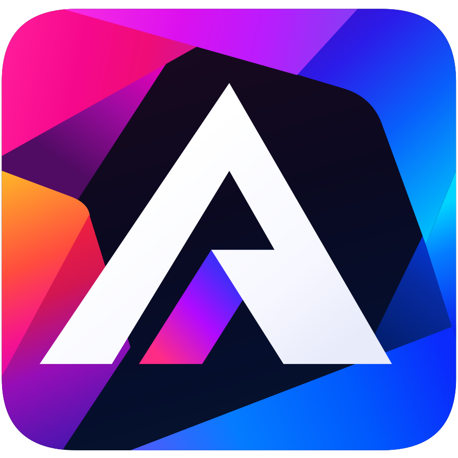

<p align="center">
  
</p>

<h1 align="center">Atelier IDE</h1>

<p align="center">
  <a href="https://github.com/ThomasFarineau/atelier-ide/releases/latest"></a>
  <a href="https://github.com/ThomasFarineau/atelier-ide/actions/workflows/ci.yml"></a>
  <a href="https://github.com/ThomasFarineau/atelier-ide/actions/workflows/docs.yml"></a>
  <a href="https://github.com/ThomasFarineau/atelier-ide/releases"></a>
  <a href="LICENSE"></a>
  
  
</p>

<p align="center">
  A fast, modern desktop IDE written in Rust.<br>
  <a href="https://thomasfarineau.github.io/atelier-ide/"><b>Documentation</b></a> ·
  <a href="https://thomasfarineau.github.io/atelier-ide/fr/">Documentation en français</a> ·
  <a href="https://github.com/ThomasFarineau/atelier-ide/releases/latest">Download</a> ·
  <a href="CHANGELOG.md">Changelog</a>
</p>

## Features

- **A clean, modern interface**: Islands themes, tool window rails, Search Everywhere, run widget and familiar shortcuts. Interface in English and French.
- **Code intelligence** for JavaScript, TypeScript, Rust and Java: tree-sitter right away, then tsserver, rust-analyzer or jdtls (completion, navigation, rename, quick actions, reformat).
- **Git**: commit window, log with branch graph, branch widget, diff, conflict resolution, blame.
- **Project tools**: terminal, run configurations, npm, Maven, Gradle, translations, Kubernetes, and viewers for Markdown, Mermaid, SVG, CSV, images and Office documents.
- **For AI agents**: an MCP server for Claude Code, Codex and Gemini CLI, AI sessions, a context graph, and commits that follow the conventions of the repository.
- **Updates itself**: a Windows installer, an `atelier` command on the PATH, and a launcher that keeps the IDE up to date.

## Install

- **Windows**: run `atelier-setup-windows-x86_64.exe` from the [latest release](https://github.com/ThomasFarineau/atelier-ide/releases/latest).
- **Linux and macOS**: download the launcher of your platform (`atelier-<os>-<arch>`) from the latest release and start it; it installs and updates the IDE next to itself.

Then `atelier .` opens the current folder. See [Installation](https://thomasfarineau.github.io/atelier-ide/guide/getting-started).

## Build from source

You need stable Rust and a native toolchain (on Windows, the Visual Studio Build Tools with the C++ workload).

```bash
cargo run -- examples/demo        # the IDE on the multi-language demo project
cargo dev                         # hot reload while you work on the IDE
cargo build --release             # target/release/atelier-ide(.exe)
```

Before a pull request:

```bash
cargo fmt --check
cargo clippy --locked --all-targets -- -D warnings
cargo test --locked
```

A change worth a line in the changelog comes with a file in `.changeset/` (see [Versions & releases](https://thomasfarineau.github.io/atelier-ide/contributing/releases)). The architecture and the development tools are described in [Development](https://thomasfarineau.github.io/atelier-ide/contributing/development).

## Documentation

The documentation lives in [`docs/`](docs) (VitePress, with [Bun](https://bun.sh)), in English and French, and is published to GitHub Pages from `main`:

```bash
cd docs && bun install && bun run dev
```

## License

Atelier IDE is released under the [MIT License](LICENSE). The bundled Inter and JetBrains Mono fonts are under the SIL Open Font License (`assets/fonts/`).
